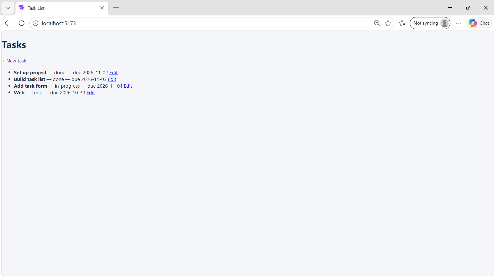

# Internship Frontend

React + Vite frontend for the Sketchverse Task Management application.

## Run locally

Install dependencies:

```bash
npm install
```

Start the development server:

```bash
npm run dev
```

## Day 4: Task form, routing and validation

### Task list

